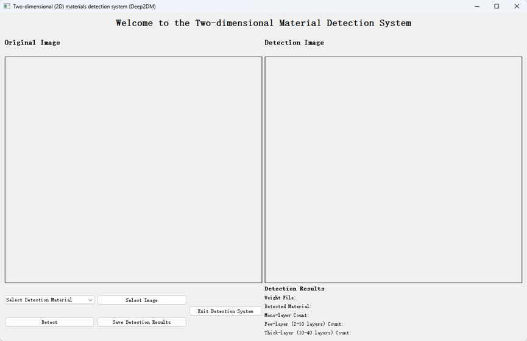
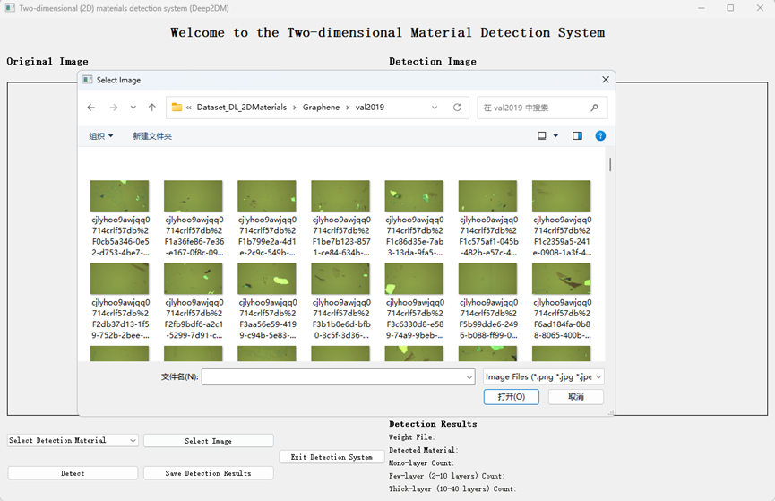
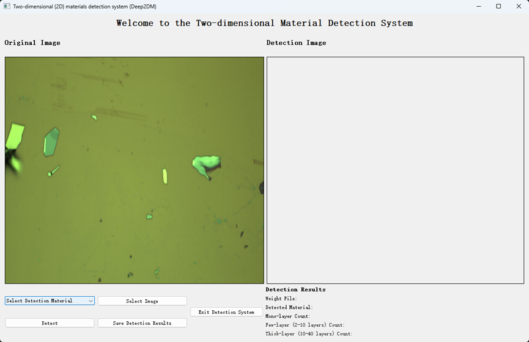
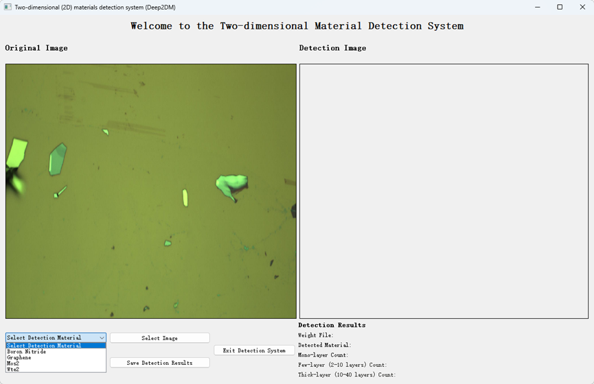
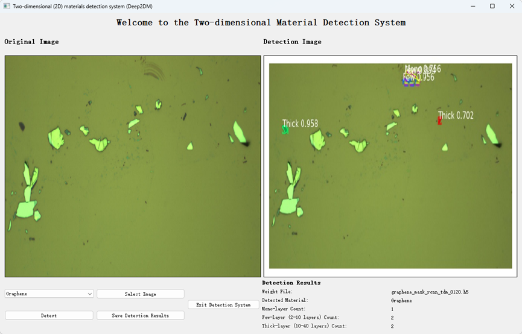

# Deep2DM

> A desktop application for intelligent detection and instance segmentation of two-dimensional materials in optical microscopy images.

Deep2DM is a graphical detection system built with **Mask R-CNN** and **PyQt5**. It is designed for optical microscopy images of exfoliated two-dimensional materials on **SiO₂/Si substrates**. The application locates material targets, generates pixel-level instance masks, displays confidence scores, and counts samples across thickness ranges.

| Item | Details |
| --- | --- |
| Current version | V1.00 |
| Language | Python |
| Core components | Mask R-CNN, TensorFlow 1.x, PyQt5 |
| Repository | <https://github.com/z-maye/Deep2DM.git> |
| Intended users | 2D-material research, laboratory teaching, and initial microscopy-image screening |

## Why Deep2DM?

The thickness, morphology, and boundaries of two-dimensional materials directly affect their physical properties and device performance. Manual screening is time-consuming and can be affected by user experience, illumination, substrate texture, and adhesive residues. Deep2DM brings image upload, material selection, detection, visualization, and result export together in one desktop interface, reducing repetitive manual work.

## Key Features

- **Image upload**: Supports local PNG, JPG, JPEG, and BMP image files.
- **Material selection**: Provides configured entries for Boron Nitride, Graphene, MoS₂, and WTe₂.
- **Intelligent detection**: Produces bounding boxes, confidence scores, instance segmentation masks, and thickness categories.
- **Thickness statistics**: Counts monolayer (Mono), few-layer (Few, 2–10 layers), and thick-layer (Thick, 10–40 layers) targets.
- **Side-by-side comparison**: Displays the original image and its annotated result together.
- **Result export**: Saves the annotated detection image to a user-selected location.



## Software Functions

The Deep2DM graphical interface provides the following functions:

1. **Select material**: Select the target material from the drop-down menu. The application then uses its corresponding configured weight file.
2. **Import image**: Use the file dialog to import a local microscopy image and preview it on the left.
3. **View results**: After detection, the right panel shows an annotated image with bounding boxes, thickness categories, and confidence scores. The lower panel lists the weight file, material name, and counts.
4. **Export result**: Save the current annotated image to a selected directory for experiment records and later review.

## Project Structure

```text
Deep2DM/
├── main.py                 # PyQt5 graphical interface and application entry point
├── detect.py               # Weight loading, image inference, and result rendering
├── requirments.txt         # Python dependencies (original filename retained)
├── mrcnn/                  # Mask R-CNN implementation
├── qt/Deep2DM.ui           # Qt Designer interface file
├── img/
│   ├── input/              # Runtime location for copied input images
│   └── output/             # Runtime location for generated result images
├── model/                  # Location for configured weight files
└── docs/images/            # README screenshots
```

## Runtime Requirements

- Python 3.6
- Windows, Linux, or macOS
- Optional: a compatible NVIDIA GPU with CUDA and cuDNN

Key dependencies include TensorFlow, Keras, PyQt5, OpenCV, scikit-image, NumPy, Matplotlib, and pycocotools. See [requirments.txt](requirments.txt) for the pinned dependency versions.

## Quick Start

Start the application from the project root:

```bash
python main.py
```

Complete a detection task as follows:

1. Select the target material in the **Select Detection Material** drop-down menu.
2. Click **Select Image** and choose an optical microscopy image.
3. Click **Detect** and wait for processing to finish.
4. Review the annotated result in the **Detection Image** panel. Different colors distinguish target regions, while labels show the thickness category and confidence score.
5. Review the selected weight file, detected material, and Mono / Few / Thick counts in the **Detection Results** panel.
6. Click **Save Detection Results** and select an output directory for the annotated image.

The selected image is copied to `img/input/`. When a target is detected, the result image is first written to `img/output/` and can then be saved to the directory selected by the user. The application displays a prompt if no material or image has been selected, or if no target is detected.

| Step | Screenshot file | Description |
| --- | --- | --- |
| Upload an image | `docs/images/step-1-upload.png` | Select a local microscopy image in the file dialog | | Preview image | `docs/images/step-2-preview.png` | View the loaded original image |

| Select material | `docs/images/step-3-material.png` | Choose the target material from the drop-down menu |
| Ready for detection | `docs/images/step-4-ready.png` | Interface state after image selection and before detection |
| Run detection | `docs/images/step-5-detection.png` | Detection result, confidence labels, and thickness statistics |






